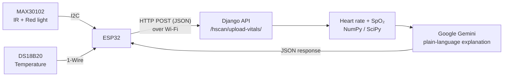

# AI-Powered Health Monitoring System — Hardware

Firmware for the sensing side of an AI-powered health monitoring system. An **ESP32** reads a person's pulse signal from a **MAX30102** pulse-oximetry sensor and their body temperature from a **DS18B20** sensor, then sends the readings over Wi-Fi to a **Django REST API**. The Django side calculates heart rate and SpO₂ and uses **Google Gemini** to explain the results in plain language.

> This repository contains the **hardware / firmware** part only. The Django backend (Auratrack) is in [kanyi-Gabriel/AI-powered-Health-Monitoring](https://github.com/kanyi-Gabriel/AI-powered-Health-Monitoring).

---

## Table of contents

- [How it works](#how-it-works)
- [Hardware components](#hardware-components)
- [Wiring](#wiring)
- [Repository structure](#repository-structure)
- [Setup and installation](#setup-and-installation)
- [Data sent to the server](#data-sent-to-the-server)
- [Testing](#testing)
- [Troubleshooting](#troubleshooting)
- [Known limitations and next steps](#known-limitations-and-next-steps)
- [License](#license)

---

## How it works



1. **Finger detection.** The ESP32 polls the MAX30102 continuously. When the IR value rises above `50000`, a finger is on the sensor and collection starts.
2. **Batching.** It stores **100 IR and 100 Red samples** (about one sample every 10 ms). If the finger is lifted before the batch is full, the partial batch is thrown away so the server never receives incomplete data.
3. **Temperature.** When a batch is complete, the DS18B20 is read **5 times** and averaged. Readings of `-127 °C` (sensor disconnected) and `85 °C` (power-on default) are rejected as errors.
4. **Upload.** The batch and temperature are packed into JSON and sent with an HTTP POST. If Wi-Fi dropped during collection, the board reconnects first. The HTTP response code and the server's reply are printed to the Serial Monitor.
5. **Server side.** Django calculates heart rate and SpO₂ from the raw IR/Red signal and returns them with a Gemini-generated explanation, which the ESP32 prints to the Serial Monitor. See the [backend README](https://github.com/kanyi-Gabriel/AI-powered-Health-Monitoring) for details.

## Hardware components

| Component | Purpose |
|---|---|
| ESP32 development board | Microcontroller with built-in Wi-Fi |
| MAX30102 module | Pulse oximeter (IR + Red LED reflectance) for heart rate and SpO₂ |
| DS18B20 temperature sensor (waterproof probe recommended) | Body temperature |
| 4.7 kΩ resistor | Pull-up for the DS18B20 data line |
| Breadboard and jumper wires | Connections |
| Micro-USB cable | Power and flashing |

## Wiring

**MAX30102 → ESP32 (I2C)**

| MAX30102 | ESP32 |
|---|---|
| VIN | 3.3V |
| GND | GND |
| SDA | GPIO 21 |
| SCL | GPIO 22 |

**DS18B20 → ESP32 (1-Wire)**

| DS18B20 | ESP32 |
|---|---|
| VDD (red) | 3.3V |
| GND (black) | GND |
| DATA (yellow) | GPIO 4 |

Place the **4.7 kΩ resistor between DATA and 3.3V**. Without it the sensor usually returns `-127 °C`.

> GPIO 21/22 are the default I2C pins on most ESP32 DevKit boards. If you use different pins, change `ONE_WIRE_BUS` or the `Wire` setup in the sketch.

## Repository structure

```
Healt_hardware/
├── health_hw/
│   ├── project_final.ino     # Final firmware: MAX30102 + DS18B20 + Wi-Fi upload
│   └── secrets.h.example     # Template for the git-ignored secrets.h (Wi-Fi + server URL)
├── max30102_test/
│   └── sketch_feb14a.ino     # Early test: MAX30102 batching and upload only
├── ds18b20_test/
│   └── sketch_feb23a.ino     # Standalone DS18B20 test (prints °C to Serial)
├── .gitignore
├── LICENSE
└── README.md
```

The two `*_test` folders were used to test each sensor on its own before combining them in `health_hw/project_final.ino`.

## Setup and installation

### 1. Install the tools

- [Arduino IDE](https://www.arduino.cc/en/software) 2.x
- ESP32 board support: in **File → Preferences → Additional boards manager URLs**, add
  `https://espressif.github.io/arduino-esp32/package_esp32_index.json`,
  then install **esp32 by Espressif Systems** from the Boards Manager.

### 2. Install the libraries

From **Sketch → Include Library → Manage Libraries**:

- **SparkFun MAX3010x Pulse and Proximity Sensor Library** (provides `MAX30105.h`, which also works with the MAX30102)
- **OneWire**
- **DallasTemperature**

`WiFi.h`, `HTTPClient.h` and `Wire.h` come with the ESP32 board package.

### 3. Configure

Wi-Fi details and the server address live in `health_hw/secrets.h`, which is git-ignored so they never get committed. Create it from the template:

```bash
cp health_hw/secrets.h.example health_hw/secrets.h
```

Then edit `health_hw/secrets.h`:

```cpp
#define WIFI_SSID     "YOUR_WIFI_NAME"
#define WIFI_PASSWORD "YOUR_WIFI_PASSWORD"
#define SERVER_URL    "http://YOUR_COMPUTER_IP:8000/hscan/upload-vitals/"
```

- Find your computer's local IP with `ipconfig` (Windows) or `ip addr` (Linux/macOS).
- The ESP32 only supports **2.4 GHz** Wi-Fi, and it must be on the **same network** as the computer running Django.
- Start Django so it listens on the network, not only on localhost:
  ```bash
  python manage.py runserver 0.0.0.0:8000
  ```

The early test sketch `max30102_test/` has placeholder values directly in the code. Replace them there if you want to run it.

### 4. Upload and run

1. Select your board (e.g. **ESP32 Dev Module**) and port under **Tools**.
2. Click **Upload**.
3. Open the **Serial Monitor** at **115200 baud**.
4. Place your finger gently on the MAX30102 and hold the temperature probe.

Expected Serial output:

```
DS18B20 Temperature Sensor initialized
Scanning for WiFi networks...
Connected to WiFi!
ESP32 IP Address: 192.168.x.x
System ready. Place finger on sensor ...
Collecting batch... 10%
...
Collecting batch... 100%
Temperature reading: 36.4
Preparing JSON payload...
Sending HTTP POST request to Auratrack backend...
HTTP Response Code: 200
Django Response: {"status": "success", "calculated_bpm": 76.9, "calculated_spo2": 97.2, "ai_interpretation": "..."}
```

## Data sent to the server

**Endpoint:** `POST /hscan/upload-vitals/`
**Header:** `Content-Type: application/json`

```json
{
  "ir_batch":  [112034, 112101, 111987, "... 100 values"],
  "red_batch": [98012,  98110,  97950,  "... 100 values"],
  "temperature": 36.4
}
```

| Field | Type | Description |
|---|---|---|
| `ir_batch` | array of 100 integers | Raw infrared readings from the MAX30102 |
| `red_batch` | array of 100 integers | Raw red-light readings from the MAX30102 |
| `temperature` | float (°C) | Average of 5 DS18B20 readings; `0.0` means the sensor failed. Sent by the device but not yet used by the backend |

The ESP32 sends raw signals rather than computed values, so the heart-rate and SpO₂ algorithms can be improved on the server without reflashing the device.

## Testing

Each part was tested in isolation before integration:

| Test | Sketch | What it checks |
|---|---|---|
| Temperature sensor | `ds18b20_test/` | Wiring and pull-up are correct; prints a reading every second and reports `Check wiring!` if disconnected |
| Pulse sensor + upload | `max30102_test/` | Finger detection, batching, JSON building and the HTTP POST to Django |
| Full system | `health_hw/` | Both sensors together end to end |

Edge cases handled in the final firmware:

- Finger removed mid-batch → batch discarded, counter reset
- DS18B20 disconnected (`-127`) or not ready (`85`) → reading rejected
- All 5 temperature readings invalid → `0.0` sent so the server can flag it
- Wi-Fi drops during collection → automatic reconnect before upload
- Server unreachable → error code printed, batch dropped, device keeps running
- MAX30102 not found at startup → clear error message and the program halts

## Troubleshooting

| Symptom | Likely cause | Fix |
|---|---|---|
| `MAX30102 not found. Please check wiring.` | SDA/SCL swapped or loose | Check GPIO 21/22 and 3.3V |
| Temperature always `-127` or `0.0` | Missing pull-up or bad data pin | Add 4.7 kΩ between DATA and 3.3V; check GPIO 4 |
| `Collecting batch...` never appears | Finger not detected | Cover the sensor fully with a fingertip; don't press too hard |
| `Error sending POST request. Code: -1` | Server not reachable | Check the IP in `serverUrl`, run Django on `0.0.0.0:8000`, same network |
| HTTP `400` from Django | Fewer than 100 samples in a batch | Check `BATCH_SIZE` is 100 or more |
| HTTP `500` from Django | Server error, e.g. Gemini API key missing or invalid | Check the Django terminal and the backend's `.env` file |
| `"Poor signal quality"` response | Finger moved or pressed too hard | Hold your finger still with light pressure |
| Wi-Fi keeps failing | Weak signal or 5 GHz network | ESP32 supports 2.4 GHz only; move closer to the router |

## Known limitations and next steps

- **Short sample window.** 100 samples at ~100 Hz is about one second of signal, only one or two heartbeats. Longer windows (4–5 s) would give more stable heart-rate and SpO₂ values.
- **No authentication or encryption.** Data goes over plain HTTP on the local network. Next step: HTTPS and an API key or token per device.
- **Not a medical device.** Readings are for learning and demonstration only and have not been validated against clinical equipment.

Planned improvements: on-device signal-quality check, OLED display for local readings, battery power, and an enclosure.

## License

This project is licensed under the [MIT License](LICENSE).

## Author

**Gabriel Kanyi** — Electrical & Electronic Engineer | Data Scientist
[GitHub](https://github.com/kanyi-Gabriel) · kanyiegabriel@gmail.com
